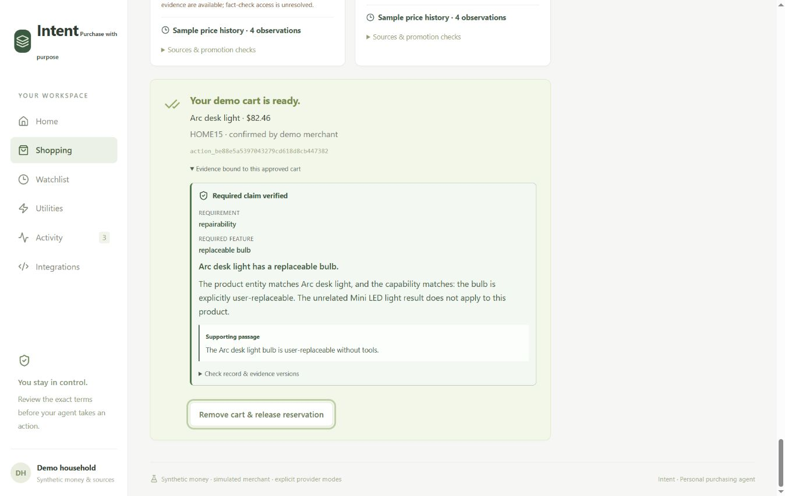
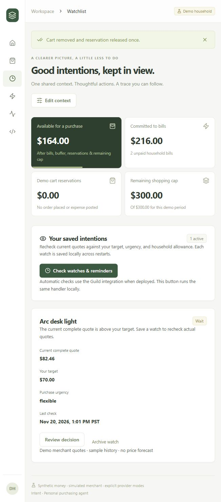

# Verification — November 20, 2026

## Final delivery verification

The delivery branch starts from `main` at `68f9841` (which already merged the foundation work) and integrates the separate `senso-corpus` commit without reverting the main-branch hardening.

- **228 backend tests passed** using isolated databases and provider mocks; no live credentials or local corpus ledger are loaded by those mocks.
- **TypeScript checking and Vite production build passed.** `git diff --check` passed.
- **Actual Senso:** five reviewed corpus claims passed against the runtime evaluation API. Three replays per case reused the idempotent check, with stable verdicts and versioned sources; they are not three independent model judgments.
- **Running FastAPI + real Senso:** supported Arc quote → proposal → explicit approval → $82.46 demo cart passed. Fold remained affordable, stocked and locally repairable, but Senso's contradiction blocked its proposal. An actual changed product/quote version blocked approval and execution. Cart removal released its reservation exactly once.
- **Controlled unavailable configuration:** a separate running app with no Senso key produced unresolved/error checks, rejected direct proposals and created no actions. This proves fail-closed behavior, not an observed outage of Senso itself.
- **Browser:** the explicit requirement selector, pending state, live claim/passages, review terms and approval/cart completion were exercised on the isolated API. Screenshot below records the actual resulting cart.
- **Cognee:** six-product smoke proof preceded bounded ingestion of 19 products; all five fact checks plus fresh-session isolation passed. Actual bounded graph exports contain 84 nodes/252 edges for catalog and 18/28 for persona A. The app's research panel returned supported and contradicted policy candidates after fresh memory/evidence reads, with proposals disabled.

Live evidence stays in ignored files: `.local/senso-corpus-check.json`, `.local/live-journey-acceptance.json`, `.local/live-unavailable-acceptance.json`, and `.local/cognee-job-smoke/`. Unit tests separately cover changed evidence, asynchronous pending checks, exact-claim mismatch, quote/run-ID stability, concurrency, transaction boundaries and approval bypass attempts.

The live application tests used `.local/intent-live-acceptance.db`, leaving the active household database and selected backend unchanged. Reproduce with `scripts/start_live_acceptance.py` and `scripts/verify_live_journey.py`; use port 8012 plus `--unavailable` for the controlled missing-key case. To view this isolated server through Vite, set `API_PROXY_TARGET=http://127.0.0.1:8011` and run `pnpm --dir apps/web exec vite --host 127.0.0.1 --port 5174`.

See [the three-minute demo](DEMO.md), [submission copy](SUBMISSION.md), [Senso's exact binding and limitations](SENSO_VERIFICATION.md), and [Cognee preparation results](COGNEE_DATA_JOB.md). Video URL, team names and contact emails remain explicit submission placeholders. Only the reviewed fictional specifications are approved Senso sources; other catalog items remain unresolved in live mode. Money and merchant actions remain simulated.

## Earlier foundation checks

- 33 Python tests passed using isolated temporary SQLite databases and disabled external credentials.
- TypeScript check and Vite production build passed.
- Actual HTTP smoke: bill confirmation/reimport, allowance change, promotion-aware approved cart, duplicate execution, removal/release, and bounded scan passed.
- Browser walkthrough: utility confirmation changed the allowance; exact HOME15 quote created a demo cart after approval and removal restored the reservation once.
- Browser Intent walkthrough: flexible urgency + $70 target yielded Wait for $82.46, saved a watch, displayed four dated sample observations, and recorded a check with no cart.
- Browser Buy walkthrough: now urgency + $90 target yielded Buy, exact approval created an $82.46 demo cart, and removal restored the $164 allowance.
- Restart tests retained tasks, audit, and watch state. Duplicate authenticated Guild run IDs return the same stored outcome.
- Tests verify hard limits, unknown charges, stale quotes/bills/budgets/preferences, ownership, competing reservations, promotion restrictions, bill revisions, flag persistence, and analytics privacy.

## Live provider checks

Initial provider checks at 2026-11-20 20:58 UTC, followed by SingleStore and Cognee setup checks in the same development session. All used private local configuration. Credentials and raw provider logs are excluded from Git.

| Integration | Observed result | What this does not prove |
|---|---|---|
| Senso | Earlier organization/context checks succeeded; final runtime fact-check and cart evidence is recorded above | Full catalog coverage, historical prices, or real merchant eligibility |
| Superlinked SIE | Account model catalog returned 54 entries; Qwen/Qwen3-Reranker-0.6B scored two synthetic products successfully | Extraction, generation, OCR, or automatic tool execution |
| Statsig | Server Core initialized with ready configuration; enable_reranker evaluated false, no matching rule ID | Gate creation, dashboard exposure visibility, or an experiment result |
| Amplitude | App-produced task_started accepted with SDK HTTP status 200; CLI reported recent traffic in the selected US project | CLI result is project-wide, not attribution to a specific event; dashboard/session visibility remains unchecked |
| SingleStore | Management access, TLS SQL login, dedicated personal_agent schema, and isolated live transaction checks passed | Existing app data remains in SQLite; no migration or production load test was performed |
| Guild | Official CLI 0.32.0 launcher verified; authenticated local handler and redelivery tests pass | Browser sign-in deferred by user; no hosted run, coordinator, or schedule |
| Cognee | Initial key/workspace check succeeded; bounded ingestion, graph recall and the research bridge are now verified above | Active household memory or executable product quotes |

SingleStore checks covered owner isolation, rollback without callbacks, optimistic conflicts, a large Unicode document, concurrent duplicate cart execution, rejection of a competing stale proposal, one action/reservation, one-time allowance release, bill deduplication, scan redelivery and state read by a new service instance. All test records were removed using their unique owner ID. The first run exposed a real 64 KiB TEXT limit; widening payload columns to LONGTEXT fixed the full task flow. The local suite was rerun afterward: 33 tests and the frontend build passed.

The app can use live evidence and optional ranking while all money, merchant actions, and seeded price observations remain synthetic. Runtime status reports the current process, not a permanently cached success from this report.
